<div align="center">


# Liga Bahiense de Arquería

**Torneos de arquería multitarget, anotados desde el celular en el monte, con o sin señal.**

El sistema de gestión de torneos de la Liga Bahiense de Arquería, organizada por el<br>
Círculo Bahiense de Arquería (CBA) en Bahía Blanca, Argentina.

[](https://github.com/BraianVaylet/bv-bahia-archers-league/actions/workflows/ci.yml)
[](https://github.com/BraianVaylet/bv-bahia-archers-league/actions/workflows/mutacion.yml)
[](LICENSE)


[**Ver el sitio en vivo →**](https://bv-bahia-archers-league-production.up.railway.app/)
&nbsp;·&nbsp; [Documentación](docs/README.md)
&nbsp;·&nbsp; [Arquitectura](docs/ARCHITECTURE.md)
&nbsp;·&nbsp; [Cómo funciona sin señal](docs/OFFLINE_SYNC.md)

<br>

<picture>
  <source media="(prefers-color-scheme: dark)" srcset="docs/assets/readme/landing-oscuro.webp">
  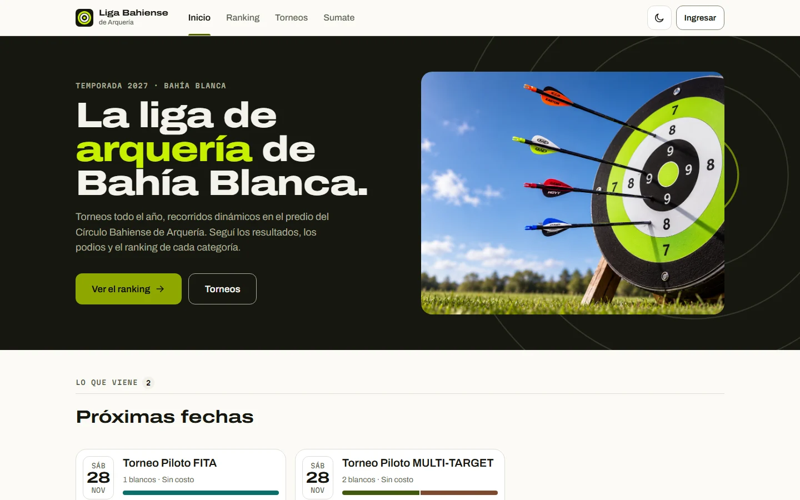
</picture>

</div>

---

## El problema

La liga corre una fecha por mes durante la temporada. Cada fecha es un **recorrido multitarget** por el predio del club: N blancos, y cada uno con su propia modalidad (18 m, aire libre, juego de campo o 3D) y su propio reglamento de flechas. Los arqueros salen en **patrullas** de 2 a 4, y el líder de cada una anota los puntajes mientras caminan por el monte.

Hasta ahora eso se hacía en planillas de papel que alguien sumaba a mano al final del día. Este sistema lo reemplaza de punta a punta: desde armar el torneo y las patrullas hasta publicar el ranking de la temporada.

> [!IMPORTANT]
> **El requisito que manda sobre todo lo demás:** la app se usa mientras se compite, con guantes, al sol y sin señal confiable. **No puede dejar de funcionar.** Cada decisión de diseño del proyecto se mide contra esa frase.

---

## Tres aplicaciones, un solo origen

| | App | Ruta | Para quién | Qué hace |
|:-:|---|---|---|---|
| 🌐 | **Landing** | [`/`](https://bv-bahia-archers-league-production.up.railway.app/) | Público | Ranking de la liga por categoría, resultados y podios de cada fecha, fichas de arqueros y alta al padrón |
| 🗂️ | **WAFA** | [`/app/admin`](https://bv-bahia-archers-league-production.up.railway.app/app/) | Administrador | Padrón de arqueros, temporadas, asistente para crear torneos, armado automático de patrullas, seguimiento en vivo, corrección y publicación |
| 🎯 | **WAFL** | [`/app/patrulla`](https://bv-bahia-archers-league-production.up.railway.app/app/) | Líder de patrulla | **Anota los puntajes blanco por blanco, junta las firmas y cierra el circuito. Funciona sin conexión.** |

WAFA y WAFL comparten una PWA instalable. WAFL guarda todo en el dispositivo y sincroniza solo cuando aparece la señal.

<table>
  <tr>
    <td align="center" width="25%">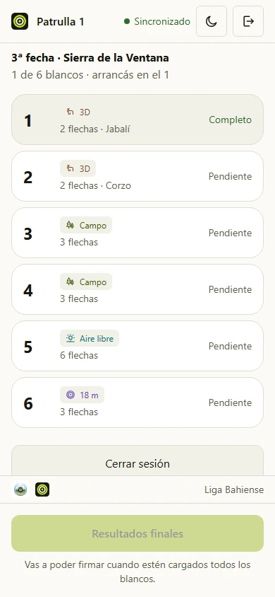<br><sub><b>WAFL</b> · el recorrido y su avance</sub></td>
    <td align="center" width="25%">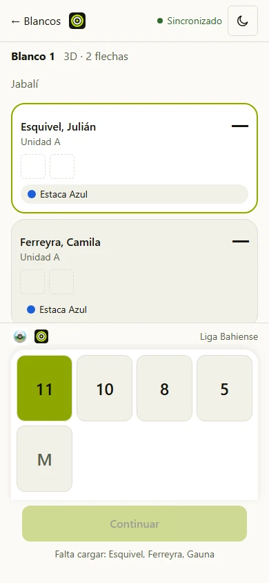<br><sub><b>WAFL</b> · teclado de scoring</sub></td>
    <td align="center" width="25%">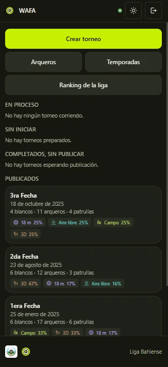<br><sub><b>WAFA</b> · torneos por estado</sub></td>
    <td align="center" width="25%">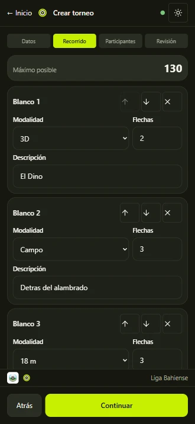<br><sub><b>WAFA</b> · armar el recorrido</sub></td>
  </tr>
</table>

---

## Cómo se juega una fecha

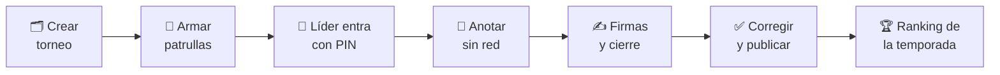

1. **Crear torneo.** El admin define fecha, temporada, participantes y el recorrido: cada blanco con su modalidad y su cantidad de flechas.
2. **Armar patrullas.** El sistema las arma solo y el admin las ajusta; cada patrulla recibe usuario y PIN impresos.
3. **Entrar.** El líder entra con el PIN una sola vez, con señal, y baja el recorrido completo al celular.
4. **Anotar.** Blanco por blanco, en el monte, sin depender de la red. Todo queda guardado en el dispositivo.
5. **Firmar y cerrar.** Cada arquero firma su puntaje en la pantalla y el líder cierra el circuito.
6. **Corregir y publicar.** El admin compara contra la planilla de papel, corrige si hace falta y publica.
7. **Ranking.** Los resultados, podios y el ranking de la temporada aparecen en la landing.

**Una fecha, varios reglamentos.** La modalidad es de cada blanco, no del torneo: un `11` vale en el blanco 3D y es inválido en el de 18 m del mismo recorrido. El servidor valida cada flecha contra el set de **ese** blanco.

<p align="center">
  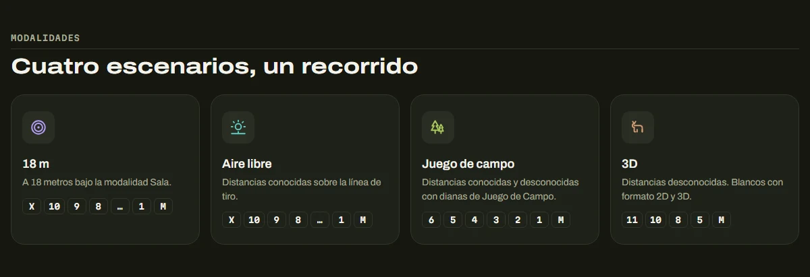
</p>

**Patrullas que se arman solas.** El algoritmo reparte a los inscriptos en patrullas de 2 a 4 arqueros con unidades de tiro homogéneas por categoría, la estaca derivada de la categoría y una regla de seguridad: **ninguna patrulla sale sin un arquero senior.** El admin puede reordenar y regenerar antes de imprimir las credenciales. Ver [`DOMAIN_WA.md`](docs/DOMAIN_WA.md) §5.

**Un ranking justo entre recorridos distintos.** Cada fecha tiene un máximo posible diferente, así que comparar puntajes brutos premiaría al recorrido más largo. El ranking promedia los mejores **porcentajes normalizados** de cada arquero en la temporada:

```
normalizedPct = (total del torneo / máximo posible de ese torneo) × 100
```

### El ciclo de vida de un torneo

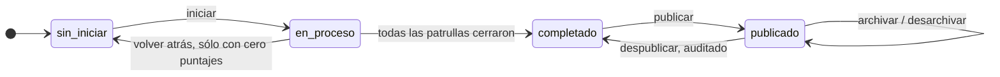

Cada transición inválida la rechaza el servidor con `409 INVALID_STATE_TRANSITION`. Qué campo se puede editar en cada estado vive en una sola tabla de `@bal/shared`, la misma que leen el servicio y el formulario. Ver [`FUNCTIONAL.md`](docs/FUNCTIONAL.md) §8.

---

## Offline-first, de verdad

No hay un «modo offline». Hay **un solo modo**, que resulta funcionar sin red: la UI de WAFL lee y escribe sólo contra IndexedDB, y la red es un detalle asincrónico que puede o no estar.

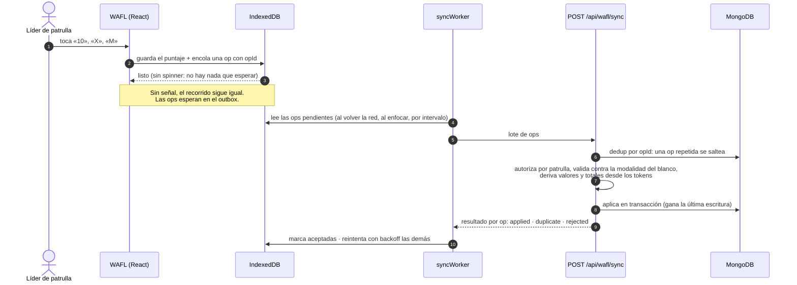

- **Idempotente.** Cada op lleva un `opId`; reenviarla diez veces deja el mismo resultado que una.
- **Conflictos deterministas.** Si dos dispositivos anotan el mismo blanco, gana la escritura más reciente, con el reloj del cliente corregido contra el del servidor.
- **Nada se descarta.** Ni ante un `401`: el trabajo del líder vuelve a intentarse cuando recupera la sesión.
- **Actualizaciones con permiso.** La PWA usa `registerType: 'prompt'`: nunca se recarga sola a mitad de un recorrido.
- **Probado sin red.** El E2E de Playwright corta la conexión en medio del recorrido y verifica que nada se pierda.

El contrato completo, la matriz de fallas y la lista de antipatrones están en [`OFFLINE_SYNC.md`](docs/OFFLINE_SYNC.md).

---

## Diseñado para el monte

<table>
  <tr>
    <td width="34%" align="center">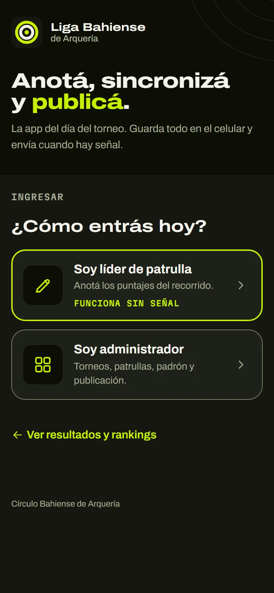</td>
    <td>

- **Objetivos táctiles de 56 px** en el teclado de scoring y 44 px en el resto: se usa con guantes.
- **Contraste para pleno sol** y tema claro / oscuro sin parpadeo al cargar.
- **Colores de estaca reservados.** Rojo, azul, amarillo y naranja significan una distancia de tiro y no se usan para nada más en toda la interfaz.
- **Indicador de sincronización siempre visible**, para que el líder sepa qué ya llegó al servidor sin tener que preguntar.
- **Presupuestos de bundle en CI**: una PWA que tiene que abrir en el monte no puede pesar lo que quiera.

Sistema visual completo en [`DESIGN_SYSTEM.md`](docs/DESIGN_SYSTEM.md).

</td>
  </tr>
</table>

---

## Arquitectura

Un contenedor, un origen, sin CORS. Hono sirve la API, la PWA y la landing; MongoDB Atlas corre como replica set para tener transacciones multi-documento.

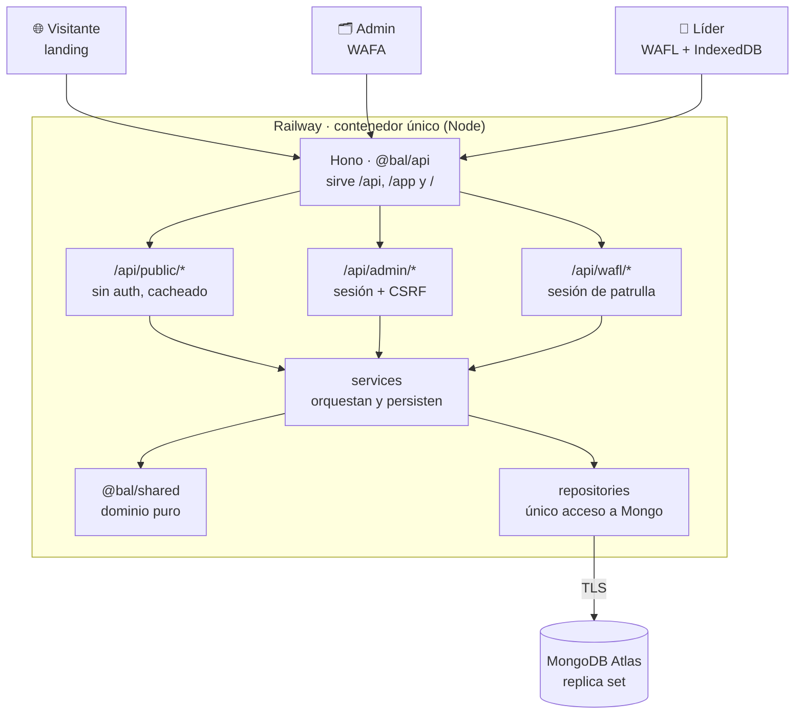

| Paquete | Rol |
|---|---|
| [`@bal/shared`](packages/shared) | **Dominio puro, sin I/O.** Scoring, armado de patrullas, rankings, estadísticas y máquina de estados. Toda regla de negocio vive acá. |
| [`@bal/api`](packages/api) | Hono + driver oficial de MongoDB. `routes` (Zod `.strict()`) → `services` (transacciones) → `repositories` (Mongo). |
| [`@bal/app`](packages/app) | PWA React con WAFA y WAFL, separadas por rol y cargadas con `React.lazy`. Offline-first con IndexedDB y outbox. |
| [`@bal/landing`](packages/landing) | Sitio público, liviano y sin service worker. |
| [`@bal/ui`](packages/ui) | Componentes, paleta, tema, tokens e imágenes compartidos. |
| [`@bal/cliente`](packages/cliente) | Cliente HTTP con CSRF y errores tipados, compartido por la PWA y la landing. |

Las capas del backend se verifican en CI (`pnpm capas`): ninguna ruta salta al repositorio y ninguna consulta a Mongo vive fuera de `repositories/`. Detalle y alternativas descartadas en [`ARCHITECTURE.md`](docs/ARCHITECTURE.md).

---

## Seguridad

El atacante realista es un participante curioso con el celular en la mano que descubre que puede editar un request. Los controles están pensados para él, sin dejar huecos para alguien más serio.

- **El servidor es la autoridad del puntaje.** El cliente manda tokens de flecha (`"X"`, `"11"`, `"M"`); el servidor deriva los valores y recalcula los totales. Un `total` en el request se ignora.
- **Autorización por op.** La patrulla 3 no puede escribir puntajes de la patrulla 5, aunque arme el request a mano.
- **Sin inyección NoSQL.** Nada del request llega a un filtro de Mongo sin pasar por Zod `.strict()`, y todas las consultas viven en `repositories/`, auditables en un solo lugar.
- **Sesiones httpOnly + CSRF**, contraseñas con **argon2id**, PIN de patrulla de 6 dígitos con rate limit, headers de seguridad y CSP.
- **Firmas que sellan el puntaje** y audit log de cada corrección, publicación y archivo.
- **Cadena de suministro:** acciones de GitHub fijadas por hash, token de CI de sólo lectura y auditoría de dependencias en cada PR.

Modelo de amenazas y checklist de release en [`SECURITY.md`](docs/SECURITY.md).

---

## Calidad

| | |
|---|---|
| 🧪 **Tests** | Más de **2.300** tests unitarios y de integración con Vitest, con MongoDB real en memoria |
| 🔁 **TDD en el dominio** | Cada regla de `@bal/shared` se escribió con el test primero, visto fallar por la razón correcta |
| 🧬 **Mutation testing** | Stryker sobre `@bal/shared` y el servicio de sincronización: mide si los tests detectan cambios, no sólo si pasan por las líneas |
| 🎭 **E2E** | Playwright en Chromium y WebKit, contra el stack real, incluido el tramo sin conexión |
| 📦 **Presupuestos** | El build falla si un bundle se pasa de su límite de peso |
| 🧹 **Lint y tipos** | Biome y TypeScript `strict` en todo el monorepo, bloqueantes en CI |

---

## Stack

<p>
  
  
  
  
  
  
  
  
  
  
  
  
</p>

Monorepo con pnpm workspaces. PWA con `vite-plugin-pwa` e `idb`. Un solo `Dockerfile` multi-stage que despliega todo en Railway.

```
packages/
  shared/    @bal/shared    dominio puro, sin I/O: scoring, patrullas, rankings
  ui/        @bal/ui        componentes, paleta, tema, tokens e imágenes
  cliente/   @bal/cliente   cliente HTTP (CSRF, ApiError) y hook de carga
  api/       @bal/api       Hono + MongoDB
  app/       @bal/app       PWA: WAFA + WAFL (offline-first)
  landing/   @bal/landing   sitio público
```

---

## Arranque rápido

Requiere Node 20+, pnpm 9 y un MongoDB **corriendo como replica set** (hace falta para las transacciones).

```bash
pnpm install
```

```bash
cp .env.example .env
```

Completar `MONGODB_URI` y los secretos en `.env`. Después:

```bash
pnpm --filter @bal/api db:indexes && pnpm --filter @bal/api db:seed
```

```bash
pnpm dev
```

API en `:8787` · app en `:5173` · landing en `:5174`.

El paso a paso completo, incluido cómo levantar MongoDB local como replica set y todas las variables de entorno, está en [`docs/CONFIG.md`](docs/CONFIG.md).

### Comandos

| Comando | Qué hace |
|---|---|
| `pnpm dev` | API, app y landing en modo desarrollo |
| `pnpm build` | `shared` → `api` + `app` + `landing`, con precompresión |
| `pnpm test` | Todos los tests unitarios y de integración |
| `pnpm test:e2e` | Playwright, incluido el flujo sin conexión |
| `pnpm lint` | Biome |
| `pnpm typecheck` | `tsc` en todos los paquetes |
| `pnpm budget` | Verifica los presupuestos de bundle |
| `pnpm capas` | Verifica las capas `routes` → `services` → `repositories` |

---

## Documentación

Todo el proyecto se documentó antes de escribirse. **El punto de entrada es [`docs/README.md`](docs/README.md).**

| Documento | De qué trata |
|---|---|
| [`FUNCTIONAL.md`](docs/FUNCTIONAL.md) | Qué hace el sistema: actores, pantallas, estados y user stories |
| [`DOMAIN_WA.md`](docs/DOMAIN_WA.md) | Reglas de arquería: modalidades, scoring, patrullas y rankings |
| [`ARCHITECTURE.md`](docs/ARCHITECTURE.md) | Topología, modelo de datos, flujos críticos y decisiones |
| [`OFFLINE_SYNC.md`](docs/OFFLINE_SYNC.md) | Cómo funciona sin señal y cómo se sincroniza |
| [`SECURITY.md`](docs/SECURITY.md) | Modelo de amenazas, controles y checklist |
| [`DESIGN_SYSTEM.md`](docs/DESIGN_SYSTEM.md) | Sistema visual y componentes |
| [`TESTING.md`](docs/TESTING.md) | Estrategia de tests |
| [`ACTION_PLAN.md`](docs/ACTION_PLAN.md) · [`BITACORA.md`](docs/BITACORA.md) | Backlog priorizado y registro de decisiones |

Si vas a contribuir o a trabajar con un asistente de IA, leé primero [`CLAUDE.md`](CLAUDE.md): son las diez reglas que no se rompen.

---

<div align="center">

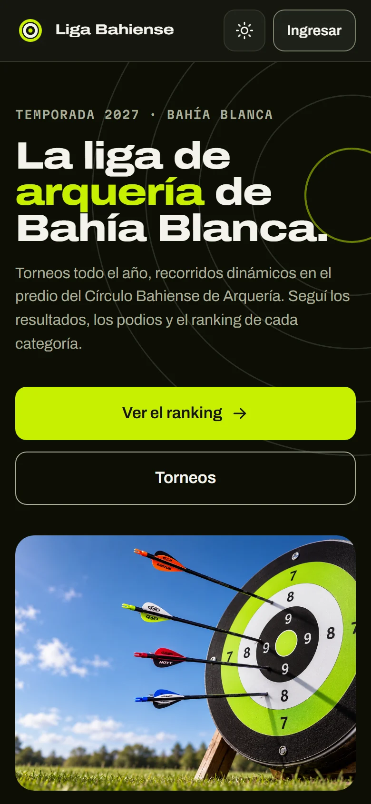

<br><br>

Hecho en Bahía Blanca para la **Liga Bahiense de Arquería** del **Círculo Bahiense de Arquería**.

[MIT](LICENSE) © 2026 Braian D. Vaylet

</div>
