# ref-7 · Antes y después

Las mismas pantallas, con los mismos datos, antes del rediseño (`main` en `07e5754`) y al cerrar `ref-7`. Las genera `e2e/capturas.spec.ts` (landing a 1280 px, PWA a 390 px); acá van reducidas a `webp`.

| Pantalla | Antes | Después |
|---|---|---|
| Landing · portada | 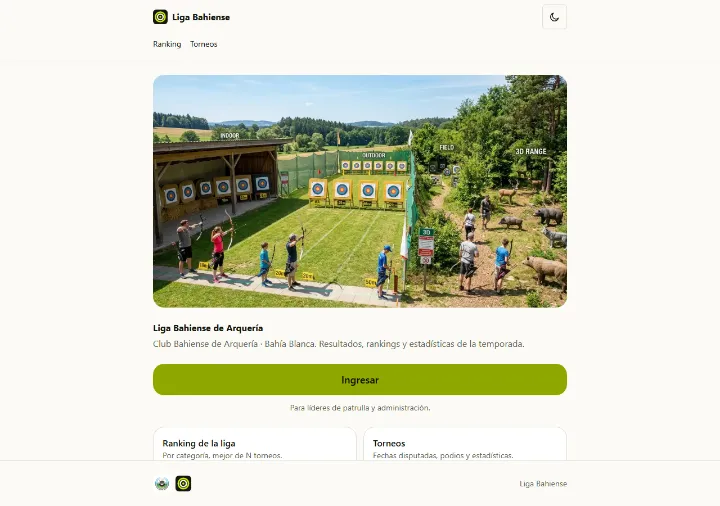 | 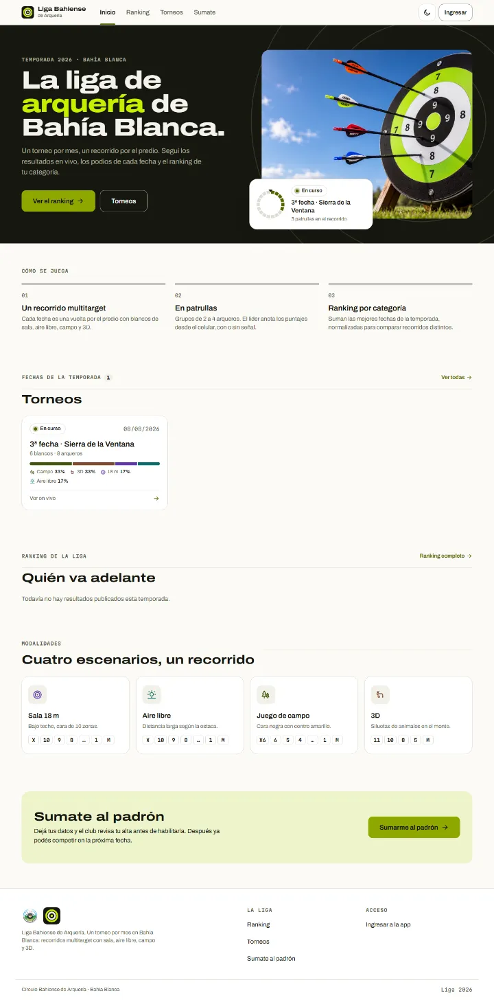 |
| Landing · torneos | 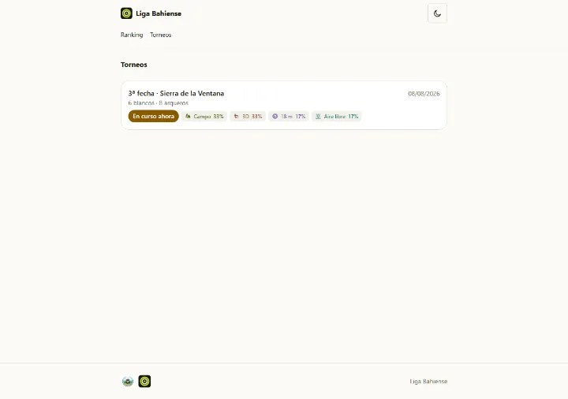 | 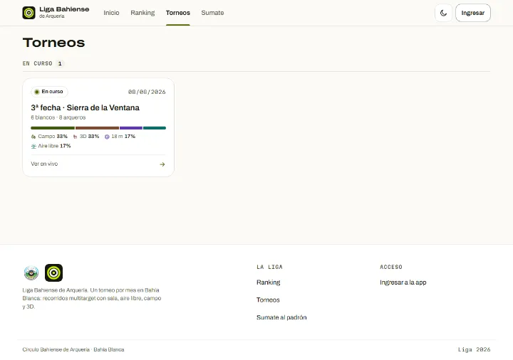 |
| Puerta `/app` | 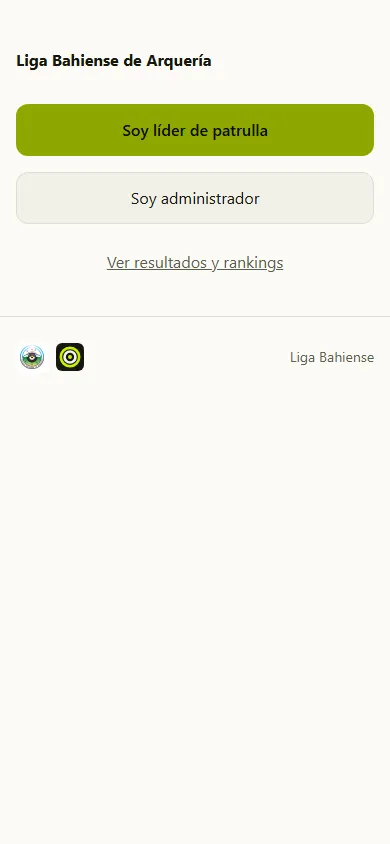 | 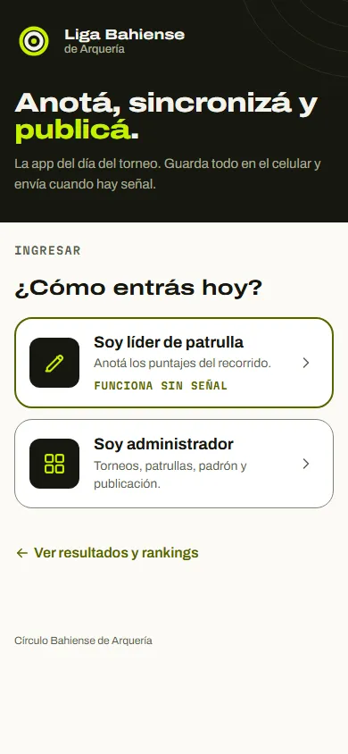 |
| WAFA · inicio | 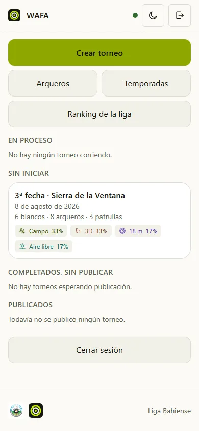 | 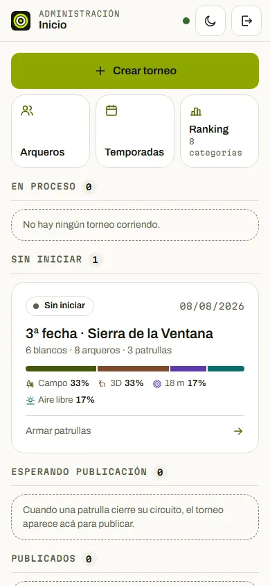 |
| WAFL · recorrido | 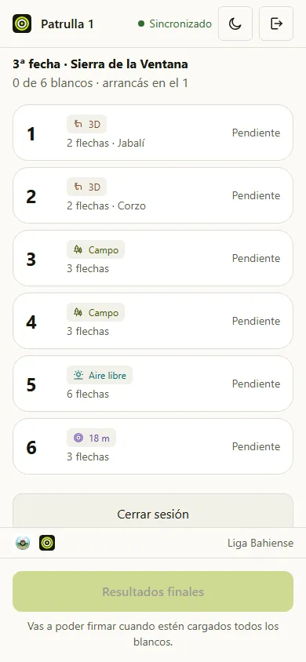 | 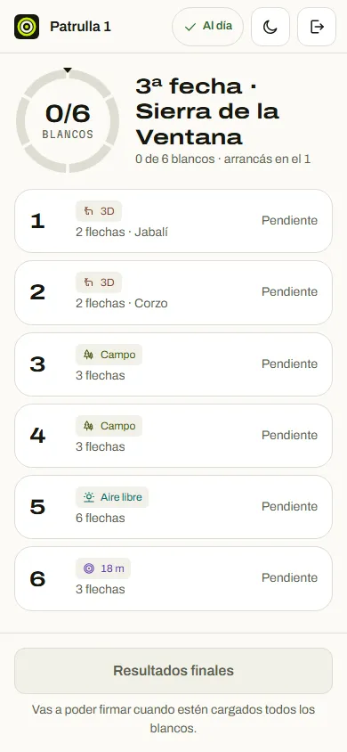 |
| WAFL · blanco | 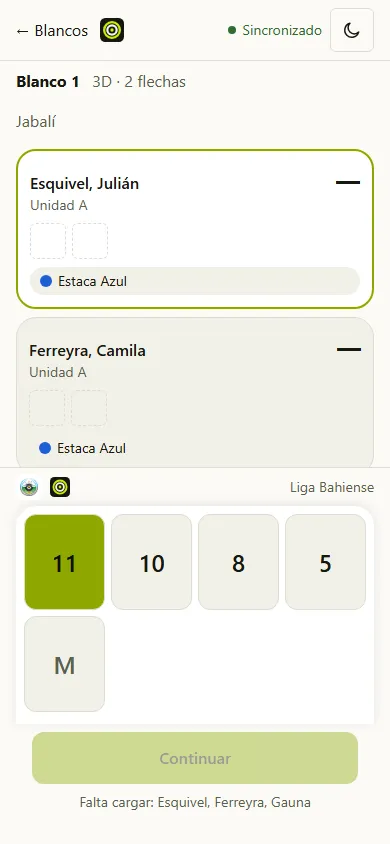 | 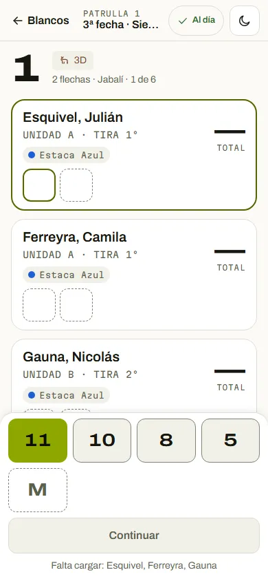 |

La portada «después» es con los datos del E2E: un torneo en curso y ningún ranking publicado todavía (por eso la sección de ranking muestra su estado vacío).
